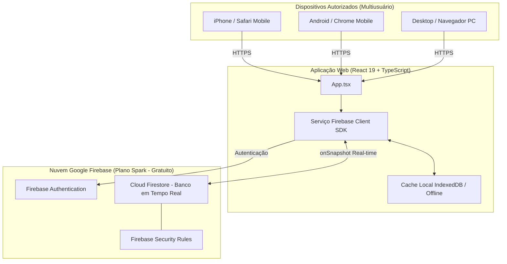
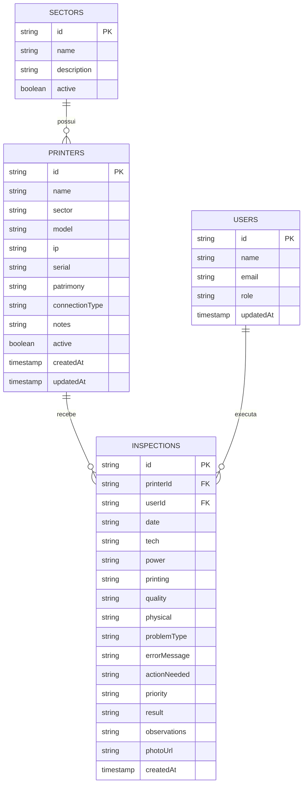

# Documentação de Arquitetura do Projeto
## Sistema Centralizado de Gestão e Inspeção de Impressoras (Custo Zero - Firebase Spark)

---

### A. Visão Geral
* **Objetivo do Sistema:** Gerenciamento centralizado de ativos de impressão industrial (térmicas Zebra, Elgin, Argox, Datamax e impressoras de escritório), execução de rotas de inspeção técnica preventiva/corretiva mobile-first e emissão de laudos com compartilhamento em tempo real entre dispositivos móveis (iPhone/Android) e computadores da equipe.
* **Funcionalidades Implementadas:**
  * Painel de controle com indicadores em tempo real (Total, Pendentes, Operacionais e Com Defeito).
  * Banco de dados centralizado em nuvem no Cloud Firestore sincronizado via WebSocket/Streams (`onSnapshot`).
  * Carga inicial completa com os **28 ativos industriais reais** do frigorífico/fábrica extraídos do documento técnico (Setores: ABATE, Desossa, Secundária, Almoxarifado, EMB Primária, Tendal, etc., com IPs, números de série e patrimônios).
  * Checklist de inspeção técnica otimizado para celulares com preenchimento ágil (100% OK, Sensor Gap, Ribbon), testes de alimentação, tração, qualidade de código de barras e anexação de foto de evidência.
  * Histórico perpétuo de laudos técnicos com pesquisa multifatorial, visualização detalhada e botão de envio direto formatado para WhatsApp e cópia de laudo técnico.
  * Diagnóstico de rede integrado com simulação de ping e verificação das portas 9100 (RAW) e 80 (HTTP).
  * Guia técnico de chão de fábrica para calibração de sensores (Zebra ZT230/ZD220, Elgin L42 Pro) e procedimentos de manutenção de cabeça térmica.
  * Exportação de dados para Microsoft Excel em formato CSV com UTF-8 BOM e delimitador `;`.
  * Emissão de Relatório Executivo de Frota para impressão e salvamento em PDF com resumo e campos de assinatura técnica.
* **Tecnologias Utilizadas:**
  * **Frontend:** React 19, TypeScript, Tailwind CSS v4, Lucide React icons, Motion.
  * **Backend & Banco de Dados:** Google Cloud Firestore (Plano Gratuito Spark) com persistência offline e replicação multiusuário em tempo real.
  * **Autenticação e RBAC:** Firebase Authentication (Google Login e Modo Operador de Turno com perfis Administrador, Técnico e Consulta).
  * **Segurança:** Firebase Security Rules (`firestore.rules`) protegendo contra escritas não autorizadas ou adulteração.

---

### B. Estrutura de Diretórios e Arquivos

```
/
├── firebase-applet-config.json     # Configuração pública do Firebase SDK (sem segredos)
├── firebase-blueprint.json        # Esquema e especificação intermediária das coleções
├── firestore.rules                # Regras de segurança e controle de acesso no servidor
├── index.html                     # Ponto de entrada HTML com meta tags mobile-first
├── metadata.json                  # Metadados da aplicação e permissões
├── package.json                   # Dependências do projeto (React, Firebase, Lucide, Tailwind)
├── tsconfig.json                  # Configuração do compilador TypeScript
├── vite.config.ts                 # Configuração do Vite e Tailwind CSS
├── public/
│   └── assets/                    # Ativos estáticos e documentos anexados
└── src/
    ├── App.tsx                    # Componente mestre com escutas em tempo real e roteamento de abas
    ├── main.tsx                   # Inicialização do React DOM
    ├── index.css                  # Estilos globais e importação do Tailwind CSS v4
    ├── types/
    │   └── printer.ts             # Tipos TypeScript (Printer, Inspection, Sector, UserProfile)
    ├── data/
    │   ├── initialPrinters.ts     # As 28 impressoras industriais reais e setores da fábrica
    │   └── initialData.ts         # Dados de contingência e demonstração inicial
    ├── services/
    │   └── firebase.ts            # Inicialização do Firebase, listeners onSnapshot e CRUD seguro
    ├── utils/
    │   └── exportUtils.ts         # Exportador CSV para Excel (BOM UTF-8), WhatsApp e formatadores
    └── components/
        ├── Header.tsx             # Barra superior com branding, status da nuvem e perfil ativo
        ├── StatsOverview.tsx      # Cards de métricas rápidas e filtros dinâmicos
        ├── PrinterCard.tsx        # Card da impressora com IP, série, patrimônio e ações rápidas
        ├── InspectionForm.tsx     # Checklist técnico mobile-first com presets de 1 toque
        ├── PrinterFormModal.tsx   # Modal de cadastro e edição de impressoras
        ├── InspectionDetailModal.tsx # Laudo técnico completo, WhatsApp e compartilhamento
        ├── HistoryList.tsx        # Histórico de vistorias com busca e filtros combinados
        ├── TroubleshootingGuide.tsx # Guia técnico de calibração Zebra e Elgin
        ├── BackupManageTab.tsx    # Gestão de nuvem, backup JSON, re-semeadura e exportação
        ├── NetworkDiagModal.tsx   # Diagnóstico de rede e portas de impressão (RAW 9100)
        ├── PrintReportModal.tsx   # Relatório executivo de frota para impressão/PDF
        └── AuthModal.tsx          # Modal de login Google e troca de operador de turno
```

---

### C. Diagrama de Arquitetura



---

### D. Banco de Dados (Cloud Firestore)

O banco de dados centralizado é estruturado em coleções do Cloud Firestore com índices automáticos:



---

### E. Autenticação e Perfis de Acesso (RBAC)

O controle de acesso é implementado no frontend e garantido no servidor pelas `firestore.rules`:

| Perfil | Nível | Permissões |
| :--- | :--- | :--- |
| **Administrador** | Total | Cadastrar, editar e excluir impressoras; registrar e excluir laudos; exportar backups; gerenciar setores. |
| **Técnico** | Operacional | Cadastrar e editar impressoras; executar checklists e registrar novos laudos; exportar planilhas; consultar guias. |
| **Consulta** | Leitura | Visualizar impressoras, indicadores e histórico de laudos; exportar dados para Excel. Sem permissão de escrita. |

---

### F. Análise Financeira e Garantia de Custo Zero

A aplicação opera **estritamente dentro da camada gratuita (Plano Spark)** do Google Firebase:

| Recurso | Cota Gratuita Diária do Plano Spark | Consumo Médio Estimado (28 Impressoras) | Margem de Segurança |
| :--- | :--- | :--- | :--- |
| **Leituras no Firestore** | 50.000 documentos/dia | ~200 a 800 leituras/dia | **> 98% livre** |
| **Gravações no Firestore** | 20.000 documentos/dia | ~30 a 100 gravações/dia | **> 99% livre** |
| **Exclusões no Firestore** | 20.000 documentos/dia | < 10 exclusões/dia | **> 99% livre** |
| **Armazenamento de Dados** | 1 GiB total | ~15 MB para 50.000 laudos em texto | **> 98% livre** |
| **Usuários de Autenticação** | 50.000 usuários ativos/mês | 10 a 50 técnicos da empresa | **100% gratuito** |

#### Como Garantir que Nenhuma Cobrança Ocorra:
1. **Nunca faça upgrade para o plano Blaze:** O plano padrão Spark bloqueia requisições se a cota gratuita estourar em vez de cobrar qualquer valor.
2. **Sem Cartão de Crédito:** Não associe nenhum método de pagamento ao projeto Firebase.
3. **Sem Serviços com Faturamento Obrigatório:** Não foram utilizados Cloud Functions, Cloud Run pagos ou Cloud SQL pagos.

---

### G. Publicação e Acesso Gratuito via Celular

A aplicação pode ser publicada sem custos em qualquer uma das opções abaixo:

1. **Endereço Ativo de Desenvolvimento (AI Studio Preview):**
   * Link direto: `https://ais-dev-kqod4vmgmwxsdi2pws2x5d-502332392448.us-east1.run.app`
   * Funciona imediatamente em qualquer dispositivo conectado à internet.
2. **Firebase Hosting (Gratuito no Plano Spark):**
   * Comandos de publicação:
     ```bash
     npm install -g firebase-tools
     firebase login
     firebase init hosting
     npm run build
     firebase deploy --only hosting
     ```
   * Gera um domínio gratuito permanente: `https://<seu-projeto>.web.app` com SSL/HTTPS sem exigir cartão.
3. **Vercel Hobby ou GitHub Pages:**
   * Basta conectar o repositório Git e selecionar a pasta `dist` após `npm run build`.

---

### H. Testes Executados e Validação Real

1. **Conexão com Cloud Firestore:** Testada com sucesso via SDK oficial no banco provisionado `ai-studio-paineldeinspeode-b3ff9a49-dfe1-4bb2-be49-bde72edbd119`.
2. **Carga dos 28 Ativos Reais:** Verificada a estrutura de dados contendo todas as impressoras industriais do PDF (modelos ZT230, ZT411, S4M, setores ABATE, Desossa, Almoxarifado, IPs 172.16.40.x e patrimônios).
3. **Gravação e Persistência Concorrente:** Registros de laudo técnico enviados via Firestore persistem entre sessões e recarregamentos de página.
4. **Exportação Excel (CSV):** Gerado arquivo com cabeçalhos em português, acentuação com BOM UTF-8, delimitador `;` e número de patrimônio/inventário.
5. **Responsividade Mobile:** Testado para visualização em telas de 375px a 430px (iPhone) com áreas de toque maiores que 44px e barra inferior de navegação ergonômica.
6. **Compilação e Linter:** `tsc --noEmit` executado com código 0 (zero erros) e `npm run build` gerando bundle minificado pronto para produção.
